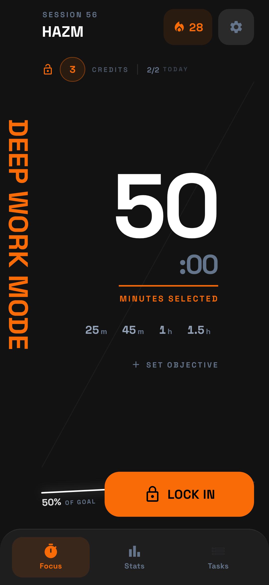
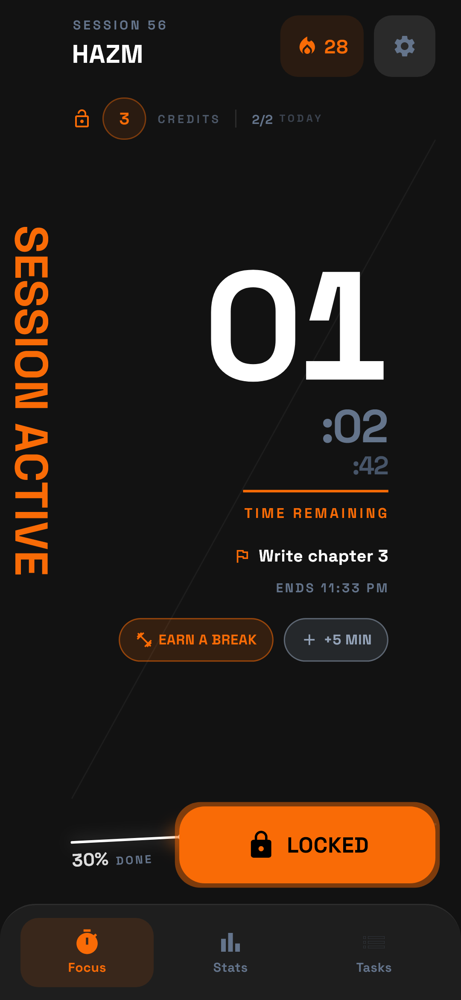
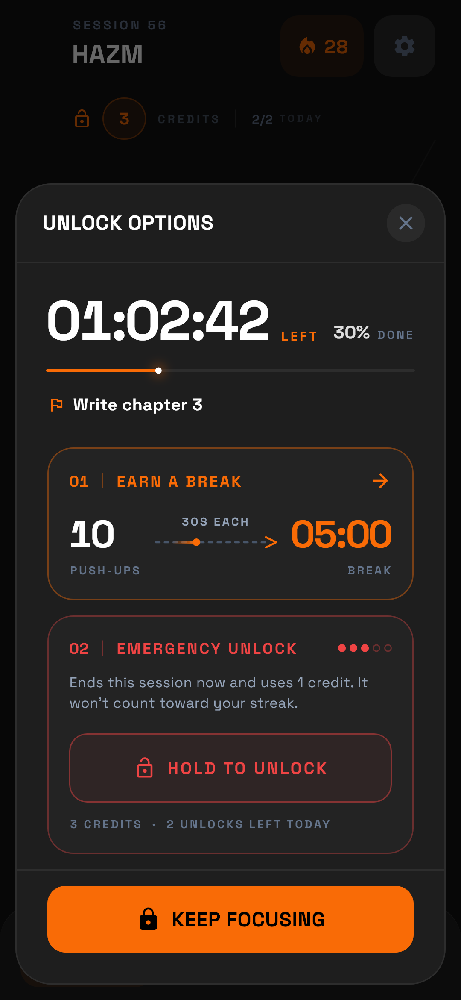
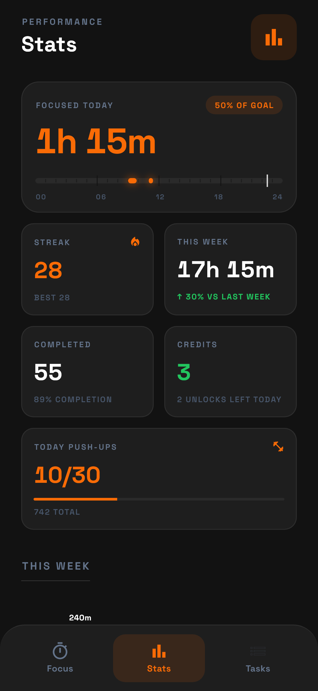
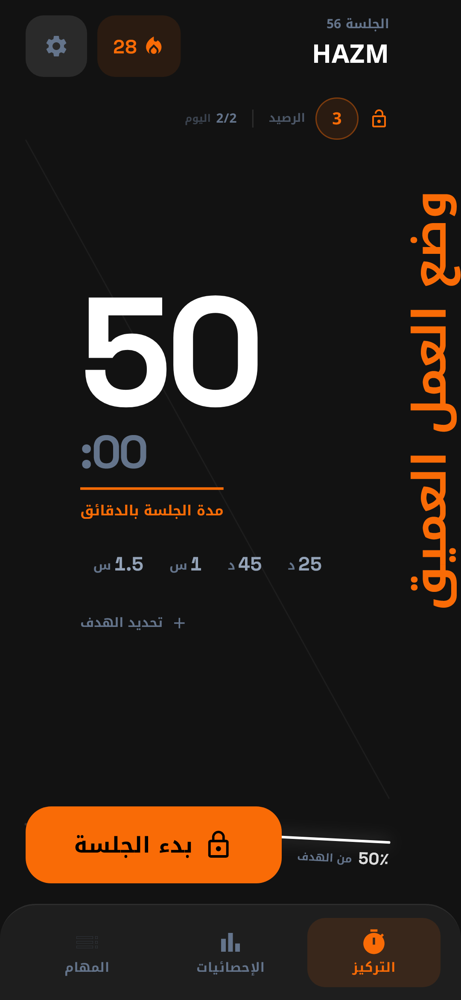
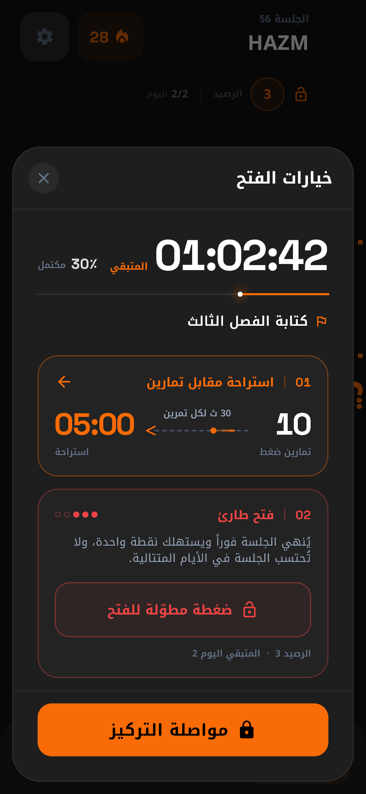

<p align="center">
  
</p>

<h1 align="center">HAZM</h1>

<p align="center">
  Deep work, without distractions.<br>
  An Android focus timer that blocks distracting apps while you work.
</p>

<p align="center">
  <a href="https://github.com/abdellhadiig/hazm/releases/latest/download/HAZM.apk"><b>Download HAZM.apk</b></a>
  &nbsp;·&nbsp; Android 8.0+ &nbsp;·&nbsp; English and العربية
</p>

<p align="center">
  
  
  
  
</p>

## Features

- **Focus sessions.** Every app is blocked except the ones you allow. Calls, messages, notes, calculator and calendar always work.
- **Lock screen.** Opening a blocked app shows a full-screen lock and returns to the home screen.
- **Push-up breaks.** Do push-ups in front of the camera to earn a few minutes off.
- **Emergency unlock.** Press and hold to end a session, using a credit earned from long sessions. You can hold up to 10 credits.
- **Stats and tasks.** Streaks, a focus map, your best hours, and an objective for each session.

## Permissions

HAZM needs a few special permissions. The app walks you through each one.

| Permission | Why |
| --- | --- |
| Accessibility service **(required)** | Sees which app is open so it can block distractions during a session. It never reads, saves or sends what is on your screen. |
| Notifications | Shows the time left and tells you when a session ends. |
| Camera | Counts push-ups. Frames are analysed on the phone and never saved. |
| Background running | Stops the phone from closing HAZM and pausing the blocking. |
| Do Not Disturb (optional) | Silences notifications during sessions. |

## Install

1. Download [HAZM.apk](https://github.com/abdellhadiig/hazm/releases/latest/download/HAZM.apk) on your phone and open it.
2. Allow your browser or file manager to install apps when asked.
3. Open HAZM and follow the setup.

On Android 13 and later, the accessibility switch may be greyed out for apps installed from a file. Go to **Settings › Apps › HAZM › ⋮ › Allow restricted settings**, then switch it on. Google Play Protect may also warn you because the app is not from the Play Store.

When a new version is out, HAZM shows it on the Focus tab. Tap **Update** to download it and install it over the current app. Your data stays.

## Privacy

No account, no server, no ads. Sessions, tasks and stats stay on your phone. Once a day HAZM asks GitHub for the latest version number; you can turn this off in Settings. Push-up detection runs on the device with Google ML Kit, which may send performance and usage metrics to Google.

## Build from source

Requires Flutter 3.24 or later.

```bash
flutter pub get
flutter build apk --release
```

Without `android/key.properties`, the release build is signed with the debug key.

---

<div dir="rtl">

## بالعربية

**HAZM** تطبيق أندرويد للعمل العميق: يحجب التطبيقات المشتِّتة أثناء جلسات التركيز، ويتيح كسب استراحة قصيرة بتمارين الضغط.

- **التنزيل:** ملف [HAZM.apk](https://github.com/abdellhadiig/hazm/releases/latest/download/HAZM.apk) من صفحة الإصدارات. يعمل على أندرويد 8.0 أو أحدث.
- **التحديثات:** عند صدور إصدار جديد يظهر تنبيه في صفحة التركيز، والضغط على «تحديث» ينزّله ليُثبَّت فوق النسخة الحالية دون فقدان البيانات.
- **الصلاحيات:** خدمة إمكانية الوصول ضرورية لمعرفة التطبيق المفتوح وحجبه أثناء الجلسة فقط، دون قراءة محتوى الشاشة. ويطلب التطبيق أيضاً الإشعارات، والكاميرا لعدّ التمارين، والعمل في الخلفية، و«عدم الإزعاج» اختيارياً.
- **أندرويد 13 وما بعده:** إذا ظهر مفتاح الخدمة معطّلاً، فالحل من: الإعدادات ← التطبيقات ← HAZM ← ⋮ ← السماح بالإعدادات المقيّدة.
- **الخصوصية:** لا حساب ولا خادم ولا إعلانات، وكل البيانات تبقى على الهاتف. يسأل HAZM موقع GitHub مرة يومياً عن رقم آخر إصدار، ويمكن إيقاف ذلك من الإعدادات. عدّ التمارين يتم على الهاتف عبر Google ML Kit، الذي قد يرسل إلى Google إحصاءات عن الأداء والاستخدام.

</div>

<p align="center">
  
  
</p>
